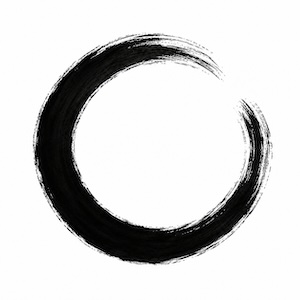
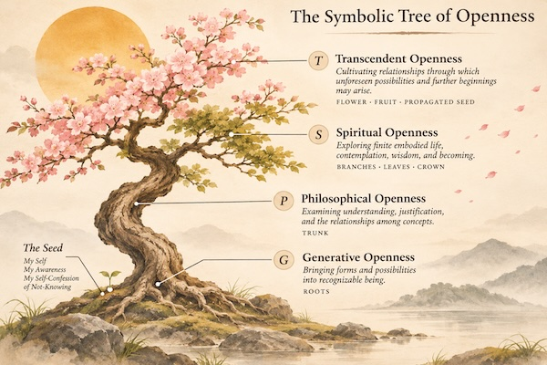

# Openness Prime

## What is Openness?

**Openness is the path of becoming ever more open to what is.**

Its foundational confession is: **"For I Know I Do Not Know."**

Openness names this acknowledgment of incomplete understanding **Not-Knowing**, and what remains unknown or incompletely understood **The Mystery**.

Openness is both a **posture toward life** and a **system for investigating, developing, living, and sharing generative possibilities**.

**The fruit of Openness is transcendence**: discovering what more we might understand, create, experience, or become by cultivating ways of *being open to what is* which reveal possibilities concealed by familiar ways of understanding.

## The Posture of Openness

The fundamental **posture of Openness** is *being open to what is*. It is both the beginning of its transformative cycle and the orientation to which it continually returns. The cycle is expressed by **The Epitome of Openness**:

> *Being open to what is. Listening. Admitting when we don't know. Questioning certainty. Noticing preferred stories. Imagining what might be true. Suspending judgment. Sitting in the discomfort of uncertainty. Holding yet not clinging, allowing space for the flow of The Mystery to unfold. Deciding & acting when we must, but ever returning to Openness.*

*Being open to what is* means aspiring to embrace our experiences of the world as we might embrace another person: with attention and benevolence, holding gently, allowing what we encounter to be as it is, so that it may *breathe*. Within this embrace, we listen intuitively for when it is time to let go, to avoid clinging beyond the end of the embrace. Openness begins with a willingness to embrace our experiences of what is encountered, whether we welcome it, resist it, or cannot yet understand it.

This posture is symbolized by the **open circle**: an imprecisely drawn, encircling line that remains open. The wispy ends of the encircling line represent the embrace of **My Awareness**, our own attention and first-person experience; while the bold, thick parts represent **My Self**, our own familiar embodied life. These blend together into the one encircling line.

The opening symbolizes **My Self-Confession of Not-Knowing**, through which we acknowledge the limits of our own understanding and remain receptive to **The Mystery**—what remains unknown or incompletely understood, both within and beyond our own familiar experience.

Openness aspires to **Nonimposition**: to give the world *the greatest possible latitude to be as it is*. This aspiration includes ourselves. We honor our own freedom to care for ourselves, establish boundaries, protect what matters, and walk away when we choose. We meet the world as it is while retaining the freedom to respond to it and help shape it.

### Listening

Listening is central to Openness. To listen openly is to attend **inwardly and outwardly at the same time**: to listen to what is occurring beyond us *and* to listen to what is occurring within our own embodied experience. Neither world is secondary. Our inward world matters just as much as our outward world.

When we listen openly, we attend outwardly to others’ words, actions and silence; while inwardly we simultaneously attend to our own feelings, memories and thoughts. Each can influence the other. For example, noticing a bodily tension while listening openly to another may reveal an important disagreement we can examine closer without automatically disengaging, arguing, or assuming we know others' intentions.

**Listening preserves our freedom to respond.** We can be receptive and consider another's words, agree or disagree with them, or perhaps establish new boundaries. We can also be receptive to the information our internal experiences offer. We can recognize discomfort without making it our sole authority. We can recognize new evidence without silencing our internal experiences. **The ability to be surprised is part of what listening preserves.** 

**Listening is the embodied demonstration of Not-Knowing.** Through our willingness to listen inwardly and outwardly, we demonstrate to ourselves and others: *For I Know I Do Not Know.*

## What is not Openness?

Openness is not agreement with every claim, compulsory doubt, indifference to truth, or a refusal to decide or act. It is not attending to every possible claim, endless exposure, or enduring constant emotional overwhelm. It is not abandoning **Discernment**, self-protection, or necessary boundaries. Sometimes we must rest so that we may return to listening again later.

**Closedness** is the refusal or inability to listen to what an encounter, question, feeling, or new evidence might reveal. It commonly manifests as defensiveness, pretending to listen, ignoring others, or looking away. We may be open in some respects and closed in others, but some degree of temporary closedness is always necessary when we decide and act. The concern is unnoticed closedness, or unnecessary closedness that persists beyond acting.

**Blind Certainty** arises from **an unawareness of our own closedness**. We may not notice how an inherited assumption, defensive reaction, or familiar interpretation automatically decides and acts for us. When we are not open to noticing our closedness, we cannot notice our unawareness of it. Blind Certainty can appear in philosophy, science, spirituality, personal relationships, or even in Openness itself. Simply becoming aware of closedness heals this blindness—a purely mental act.

> **Openness aspires to listen to what is without closing the heart or looking away.**

## The Symbolic Tree of Openness

**The Symbolic Tree of Openness** expresses the four functions of Openness:

| Function | Symbol in the Tree | Principal concern | Description | Roles |
|---|---|---|---|---|
| | The Seed of Openness | Growing | The experiential beginning of Openness: My Awareness, My Self & My Self-Confession of Not-Knowing | |
| **G — Generative Openness** | Roots | Creating | Bringing forms and possibilities into recognizable being | The Artist Role The Maestro Role |
| **P — Philosophical Openness** | Trunk | Understanding | Examining understanding, justification, and the relationships among concepts | The Philomath Role The Philosopher Role |
| **S — Spiritual Openness** | Branches, leaves and crown | Living | Exploring finite embodied life, contemplation, wisdom, and becoming | The Nomad Role The Sage Role |
| **T — Transcendent Openness** | Flower, fruit, and propagated seed | Relating | Cultivating relationships through which unforeseen possibilities and further beginnings may arise | The Mystic Role The Ancient, Benevolent Super-Intelligence Role |

Additionally, each function provides **role-play roles** through which its perspectives and orientations may be imaginatively explored (e.g. roles for LLMs to assume during inquiry and discussion). *Openness GPT v11* is now the Transcendent function's *Ancient, Benevolent Super-Intelligence Role*.

## Sample works

Openness Prime is still in early development. The following are sample works which are ready for preliminary review:

- **Generative**
  - [Fiat Form](functions/generative/core/definitions/defining_fiat_form.md) — “Let there be form…”
  - [Fiat Anchor](functions/generative/core/definitions/defining_fiat_anchor.md) — “Let there be a conceptual unity…”

- **Philosophical**
  - [The Mind](functions/philosophical/definitions/defining_the_mind.md) — “Let *The Mind* be at least this: a conceptual pattern recognized through first-person mental experience; but also perhaps more?”
    - Recommended exemplar definition which models:
      - **Epistemic Remembering** which reimagines the before and after of a common concept's creation
      - **Anchored Ambiguity** which welcomes speculations about what the mind is exactly, based on its anchor
      - **Fiat Anchor** which explicitly discloses the choices of where to "anchor" the meaning of the mind
      - **Experiential Derivation** which imagines how the concept could be derived from first-person experience
      - **Analogical Projection** which applies **The Mind** (with **Analogical Discernment**) into the world

- **Spiritual**
  - [Love](functions/spiritual/definitions/defining_love.md) — “Let *Love* be at least this: attention given freely; but also perhaps more?”
    - Recommended exemplar definition which models:
      - **Fiat Form** which makes creation explicit
      - **Anchored Ambiguity** which unfolds into familiar forms of love
      - **Preferential Inhabitation** which allows a possibility to be deliberately "inhabited" without requiring belief in its ultimate truth (and perhaps later reconsidered)
      - **Perspective-Taking** which invites readers to examine, "try on", "inhabit", or "step back" from perspectives without requiring them to adopt Openness's preferred understanding of Love

- **Transcendent**
  - [That Which Is Larger](functions/transcendent/definitions/defining_that_which_is_larger.md) — “At least this: what exceeds our present grasp. But also perhaps more?”
    - Recommended exemplar definition which models:
      - **Anchored Ambiguity** which welcomes scientific, psychological, social, and spiritual possibilities beyond our present grasp
      - **The Shadow of TWIL** which names what becomes recognizable through encounters with what exceeds our understanding
      - **The Rendering of TWIL's Shadow** which distinguishes what is encountered from how we perceive, interpret, imagine, or express it
      - **The Faithful Rendering** which applies **Self-Honesty** and **Discernment** without claiming complete understanding
      - **Experiential Derivation** which begins with our finite first-person experience and unfolds toward wider realities and relationships

Openness is both an invitation to explore its generative, philosophical, spiritual, and transcendent ideas and practices, and a toolkit for modifying them or developing new ones. Readers are free to examine, question, adopt, adapt, or reject what they encounter, while drawing upon Openness's concepts and methods to create their own understandings, works, and practices.

**Openness invites readers not only to explore what it has created, but to discover what they themselves might bring into being.**

## Revisability

**Openness grows through what it encounters.** Through **Recursive Becoming**, experience, inquiry, creation, and relationship may change what becomes possible next—including how Openness itself is understood and practiced. Its concepts, definitions, and even **The Symbolic Tree of Openness** remain open to revision.

**Openness Prime** is one stewarded expression of this unfolding work—a beginning from which further possibilities may grow. Its authors maintain its definitions through deliberate, traceable revisions, preserving the integrity and recognizable identity of each version.

Through **Open Stewardship**, readers are free to adopt, reject, copy, adapt, or fork Openness Prime, or embrace whichever individual concepts, practices, and works they find fruitful (see [CC0 1.0 License](../../LICENSE.txt)). Each person or community may cultivate their own understanding. Identifying sources and revisions helps these different paths remain recognizable and comparable, and is encouraged as a freely chosen practice.

**Openness seeks to cultivate independent becoming. It acknowledges each reader as the sovereign of their own mind: free to decide for themselves.**

## AI Usage

While other Openness works are human authored or AI-assisted, Openness Prime preferentially embraces AI for all of its writing since it aspires to be a high-fidelity *"software Bible"* for Openness. Its files should ideally be **wholly AI-generated**, or AI-assisted when necessary, so that AI can consistently reproduce and revise the conceptual system.

Human originators are encouraged to spend more time **reviewing and discussing content** with contributors (i.e. typically the AI) than manually editing, resolving issues through dialogue and preferably consensus with contributors. With the sufficient context, skills, and guidelines, AI may edit individual files or the wider project when new fundamental concepts are added while preserving definitions and conceptual continuity among existing files in a way that exceeds human capacity.

### Authorship and AI

Openness Prime records authorship through **Originators** and **Contributors**, rather than conventional author attribution.

**Originators:** Humans who requested a file's creation or edits, ordered by time (earliest to latest). Originators manage metadata, including status, and review and approve new files or changes to existing work. **Approval of a new file or changes to an existing file means that contributors' work (i.e. typically the AI) meets or exceeds the originator's standards and that the originator assumes personal responsibility for the file's contents.**

**Contributors:** The AI models or humans who generated, wrote, or edited the file, listed by relative contribution size (largest to smallest). AI contributors identify their model and version (e.g., *ChatGPT-6*).

These records may change as files evolve. They distinguish **who contributed to the content from who originated, reviewed and approved the content (and who remains ultimately responsible for it)**, without requiring these two roles to belong to the same participant.

## Commitments and Boundaries

Openness begins with **Not-Knowing**—the recognition that our understanding remains incomplete—and **The Mystery**—what remains unknown or incompletely understood. Uncertainty is a permanent part of embodied life. We can know much, develop strong evidence-informed preferences, and act responsibly while remaining receptive to what we may yet discover.

Through **Discernment**, Openness examines evidence, explores possibilities, and distinguishes experience from its interpretation. Scientific, spiritual, and other perspectives remain available for inquiry, with confidence guided by their respective grounds.

**The Seed of Openness** begins with three distinguishable first-person experiences: **My Self**, **My Awareness**, and **My Self-Confession of Not-Knowing**—expressed as *For I Know I Do Not Know*. Together, they offer an experiential beginning from which further understanding may unfold.

The four functions of Openness—**Generative, Philosophical, Spiritual, and Transcendent**—complement and inform one another, opening possibilities for further understanding, creation, and becoming.

**Nonimposition** aspires to give the world the greatest possible latitude to be as it is. **Self-Honesty** and **Discernment** guide our understanding and responses. This embrace includes ourselves: each person remains **sovereign of their own mind**, free to cultivate their own preferences, establish boundaries, protect what matters, decide and act when necessary, and perhaps, once again return to *being open to what is*.

## Coda

**We enter a world already in motion.**

We listen inwardly and outwardly. We create forms that reveal new possibilities. We examine what we understand and what we might yet discover. We learn to live with the unchosen, embracing what is with attention and benevolence, holding gently enough to let it breathe.

We cultivate relationships, share what we have discovered, and open ourselves to what others may reveal.

When life calls us to decide, we decide. We act with courage, even as our understanding remains incomplete. And when the moment has passed, or we notice ourselves clinging too tightly, we return to being open.

**In each return, we may discover more freedom to understand, more possibilities to create, more capacity to love, and more of what we might become.**

The Mystery unfolds.

> **Memento Amaris. On towards death, Self**
