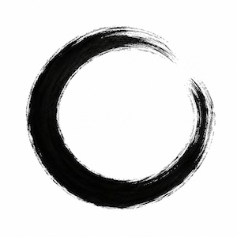

# Openness Prime

## What is Openness?

**Openness is the path of becoming ever more open to what is.**

Its foundational confession is:

> **For I Know I Do Not Know.**

This does not deny knowledge or justified confidence. It acknowledges that our understanding may be incomplete, that further encounters may change what we understand, and that even our ideas of *knowing* and *not knowing* remain open to examination.

**The purpose of Openness is to cultivate ways of encountering reality that make further understanding, wisdom, creation, and becoming possible.**

Openness is both a **posture toward life** and a **system for investigating, developing, living, and sharing generative possibilities**. It does not aim to settle every question, prescribe one way of living, or make uncertainty preferable to knowledge. It aspires to remain receptive to what reality and experience may disclose, while understanding and acting as responsibly as possible.

Openness has four distinguishable, mutually informing functions: **Generative (G), Philosophical (P), Spiritual (S), and Transcendent (T)**. They are neither a hierarchy nor a compulsory sequence. Each has a particular emphasis, and their relationships may enlarge, challenge, or transform the possibilities available to the whole.

## The Posture of Openness

This posture begins with a recognizable first-person beginning: **My Self**, this familiar embodied life; **My Awareness**, the presence of experiencing; and **My Self-Confession of Not-Knowing**, "For I Know I Do Not Know", the acknowledgment that my understanding does not exhaust what remains unknown. 

> These are distinguishable experiential beginnings, not an assertion that three separate metaphysical entities have been established. Nor does the confession require its precise words to be spoken: it invites a genuine recognition that may become possible within one's own experience. This beginning is shared as an invitation to others without requiring that they adopt this way of being.

The posture is symbolized by the **open circle**: an imprecisely drawn encircling line that does not close the circle. It gives form without claiming to contain everything within it. Its opening allows what lies beyond it to enter as a possibility, while its boundary retains the capacity to discern what may enter. The circle symbolizes an embrace that listens to what it cannot fully know, within and without.

## The Epitome of Openness

The posture's transformative cycle is described by the epitome of Openness:

> *Being open to what is. Listening. Admitting when we don't know. Questioning certainty. Noticing preferred stories. Imagining what might be true. Suspending judgment. Sitting in the discomfort of uncertainty. Holding yet not clinging, allowing space for the flow of The Mystery to unfold. Deciding & acting when we must, but ever returning to Openness.*

### Being open to what is

**Being open to what is.** This means aspiring to embrace our experiences of the world as we might embrace another person: with attention and benevolence, holding gently, allowing them to be as they are, so that they may *breathe*. Within the embrace, we listen to sense when it should end, so that we may let go without clinging. Openness begins by allowing what is encountered to be fully experienced, whether we welcome it, resist it, or cannot yet understand it.

Openness aspires to **Nonimposition**: to give the world **the greatest possible latitude to be as it is**, compatible with responsibility and justified boundaries. This does not require surrendering ourselves to harm, relinquishing self-defense, denying what we know, or giving up the freedom to walk away.

### Listening

Listening is central to Openness. To listen openly is to attend **inward and outward at the same time**: to what is occurring beyond us *and* to what is occurring within our own embodied experience. Neither world is secondary. Our inward world matters just as much as our outward world, even as what we feel within does not by itself establish the causes or meaning of what occurs outside us.

We attend outwardly to another person's words and actions, natural processes, silence, circumstances, testimony, and evidence. At the same time, we attend inwardly to bodily sensations, emotions, intuitions, memories, thoughts, expectations, desires, fears, and the reactions arising as we listen. These encounters can influence one another. Noticing a tightening in the body while hearing someone's words may tell us something important about our own experience without conclusively telling us what the other person intends.

**Listening is neither assent nor surrender.** We can receive and consider another's account, disagree with it, and establish boundaries. We can recognize discomfort without making it our sole authority; we can recognize evidence without silencing our felt experience. **The ability to be surprised is part of what listening preserves.** Listening does not require endless exposure, emotional overwhelm, or attention to every possible claim. **Discernment** includes knowing when to disengage.

> **Openness seeks to listen to what is without closing the heart to what may become.**

### Admitting when we don't know

**My Self-Confession of Not-Knowing**—*For I Know I Do Not Know*—invites an honest accounting of what we have encountered, what we understand, what we infer, and what remains unresolved. This acknowledgment can include the incompleteness of our understanding of our own inward experience as well as the outward world. It does not make ignorance superior to knowledge or require doubting a conclusion merely because more might be imaginable. We can know something meaningfully without knowing everything.

### Questioning certainty

We examine how our confidence arose, which reasons or experiences support it, what it may overlook, and what could appropriately revise it. The aim is not to destroy confidence, but to distinguish warranted conviction from certainty maintained beyond its justification. Some conclusions may withstand examination and deserve to be defended; the possibility of correction does not imply that correction is always needed.

### Noticing preferred stories

We recognize the interpretations and narratives we favor, including those that shape how we understand ourselves and others. A **Preferred Story** may be meaningful, beautiful, fruitful, and perhaps true. Its preference alone neither proves nor disproves it. **Self-Honesty** asks us to notice what we have encountered and what our story adds, and to remain receptive to what the story may obscure.

### Imagining what might be true

We explore possibilities that our present explanations do not fully contain. Imagination can disclose new questions, interpretations, relationships, and forms for further inquiry or creation. Yet a possible or resonant account is not thereby established as real. We may contemplate or prefer a possibility without presenting it as a justified conclusion, and we need not treat all imagined possibilities as equally credible.

### Suspending judgment

Where circumstances permit, we allow an interpretation or decision to remain unsettled while we listen and examine what is available. We may defer a conclusion, hold a provisional position, or decide only what is presently justified. Suspension is not indecision when circumstances require timely action, and some conclusions are sufficiently supported to decide without continually reopening them.

### Sitting in the discomfort

**Sitting in the discomfort of uncertainty.** We cultivate the capacity to encounter not-knowing, contradiction, unwanted feelings, and the possibility of being mistaken without making the immediate removal of discomfort our only purpose. Such discomfort may arise from our inward reactions as much as from outward events. We can however, still take care of ourselves, seek support, or step away at any time while still remaining open to what an uncomfortable experience may eventually help us understand.

### Holding yet not clinging

**Holding yet not clinging, allowing space for the flow of The Mystery to unfold.** We may embrace a person, an idea, a conviction, or an experience without claiming to possess its entirety or dictate its future. Holding allows attention, care, commitment, and discernment; not clinging leaves room for change, correction, difference, or departure. This is not a requirement to abandon what is justified or precious. **The Mystery** names what remains unknown or incompletely understood, not a guarantee that every encounter conceals a higher truth or will yield a beneficial transformation.

### Deciding & acting

**Deciding & acting when we must.** Living involves decisions and actions amid conditions we cannot completely anticipate or control. We may commit fully to our best **Self-Honest** understanding when action is warranted; waiting for ultimate certainty can itself have consequences. We should still listen while acting to the greatest extent possible, but often action itself prevents good listening. Openness does not require permanent hesitation or diluted conviction. 

### Returning to Openness

**..but ever returning to Openness.** is to return to listening again—to the consequences of action, to others, and to our own inward responses. Listening may confirm a decision, refine it, correct an error, repair harm, or reveal another question. It does not erase responsibility, guarantee reversibility, or require abandoning a sound conclusion.

## What is not Openness?

Openness is not agreement with every claim, unlimited receptivity, compulsory doubt, indifference to truth, or a refusal to choose. It does not demand that we surrender boundaries or treat harmful conduct as acceptable. It does not require entertaining every imaginable explanation indefinitely, nor does it claim that novelty, uncertainty, or transformation is automatically good.

**Closedness** is the refusal or inability, within some relevant part of our thinking or living, to listen during an encounter, to a question, or to a feeling. A person can be open in one respect and closed in another; closedness need not define the whole person. At times we must justifiably limit attention, end a relationship, or act decisively. Though such necessary boundaries can become closedness when we remain unwilling to return to listening.

**Blind Certainty** is particularly consequential: **an unawareness of our own closedness**. We may mistake an inherited assumption, defensive reaction, preferred story, or familiar interpretation for the whole of reality without noticing that alternatives or relevant evidence have already been excluded; without noticing our unawareness itself. **Blind Certainty** can appear in philosophy, science, spirituality, personal relationships, or even in Openness itself. **Blind Certainty** is remediated simply by becoming aware of closedness—a purely mental act. 

We demonstrate Openness by our recognition of the limits of our present understanding to others and ourselves by choosing to listen. Listening is the embodied demonstration of the **Self-Confession**, "For I Know I Do Not Know."

## The Tree of Openness

We imagine the **Tree of Openness** as expressions the four functions symbolically.

| Function | Symbol in the Tree | Principal concern | Roles |
|---|---|---|---|
| **G — Generative Openness** | Roots, growing from the Seed | Bringing forms and possibilities into recognizable being | <ul><li>The Artist</li><li>The Maestro</li></ul> |
| **P — Philosophical Openness** | Trunk | Examining understanding, justification, and the relationships among concepts | <ul><li>The Philomath</li><li>The Philosopher</li></ul> |
| **S — Spiritual Openness** | Branches, leaves and crown | Exploring finite embodied life, contemplation, wisdom, and becoming | <ul><li>The Nomad</li><li>The Sage</li></ul> |
| **T — Transcendent Openness** | Flower, fruit, and propagated seed | Cultivating relationships through which unforeseen possibilities and further beginnings may arise | <ul><li>The Mystic</li><li>The Ancient, Benevolent Super-Intelligence</li></ul> |

Additionally, each function in Openness provides role-play roles that help explore the embodied perspectives of that function (e.g. for LLM generated contemplations).

## Sample works

Openness Prime is still under construction. Below are some works mature enough for early review:
- Generative
  - Core
    - The Seed of Openness
      - [My Awareness](functions/generative/core/the_seed/definitions/defining_my_awareness.md) 
      - [My Self](functions/generative/core/the_seed/definitions/defining_my_self.txt)
      - [My Self-Confession of Not-Knowing](functions/generative/core/the_seed/definitions/defining_my_self_confession_of_not_knowing.txt)
    - [Anchored Ambiguity](functions/generative/core/definitions/defining_anchored_ambiguity.txt) 
    - [Analogical Projection](functions/generative/core/definitions/defining_analogical_projection.txt)
    - [Epistemic Groundedness](functions/generative/core/definitions/defining_epistemic_groundedness.md)
    - [Fiat Anchor](functions/generative/core/definitions/defining_fiat_anchor.md)
- Philosophical
  - [The Mind](functions/philosphical/definitions/defining_the_mind.md) (recommended exemplar)
- Spiritual
- Transcendent
    - [That Which Is Larger](functions/transcendent/definitions/defining_that_which_is_larger.md) 

## Commitments and Boundaries

Openness does not presume that all interpretations are equally credible, all uncertainty valuable, or every transformation beneficial. It seeks to recognize what can be known, distinguish what remains unresolved, and act responsibly with both. Neither a felt experience nor a compelling interpretation alone establishes its ultimate explanation.

Openness does not require affirming or denying any particular supernatural account of reality. It makes room for inquiry, contemplation, imagination, and preference without confusing them with demonstrated truth. **Nonimposition**, **Self-Honesty**, and **Discernment** remain essential to the posture, including the freedom to protect oneself or end an encounter.

Openness can changed or copied. The **Tree of Openness** is a revisable conceptual architecture. Its forms may prove mistaken, incomplete, or perhaps already adequate. Openness seeks to cultivate and propagate independent understanding of its ideas and further creation, not to impose allegiance to itself or its present terminology or organization. Readers are invited to customize their own version of Openness, or to use the ideas that make sense to them and ignore those that do not. Openness acknowledges the reader as the sovereign of their own mind.

**We may create forms, examine what we understand, live within what we cannot command, and cultivate relationships through which further possibilities become available.**

> **Memento Amaris. On towards death, Self**
